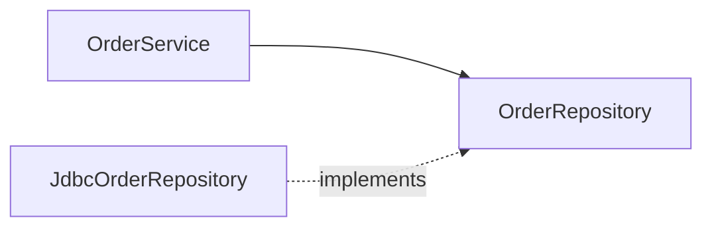

# SOLID
### SRP · OCP · LSP · ISP · DIP · DI

---

## План

1. SRP — принцип єдиної відповідальності <!-- element class="fragment" -->
2. OCP — принцип відкритості/закритості <!-- element class="fragment" -->
3. LSP — принцип заміщення Лісков, контрактне програмування <!-- element class="fragment" -->
4. ISP — принцип розділення інтерфейсів <!-- element class="fragment" -->
5. DIP — інверсія залежностей, IoC, Dependency Injection <!-- element class="fragment" -->
6. Практика <!-- element class="fragment" -->

---

## SOLID

| | Принцип | Суть |
|---|---|---|
| **S** | Single Responsibility | одна причина для змін |
| **O** | Open/Closed | розширення без модифікації |
| **L** | Liskov Substitution | нащадок замінює предка |
| **I** | Interface Segregation | малі інтерфейси під клієнта |
| **D** | Dependency Inversion | залежність від абстракцій |

Роберт Мартін, ~2000.

---

# SRP

---

## Принцип єдиної відповідальності

Модуль має **одну причину для зміни** — відповідає перед **одним актором**.

```java
public class Employee {
    public Money calculatePay()   { ... }  // бухгалтерія
    public Duration reportHours() { ... }  // відділ кадрів
    public void save()            { ... }  // адміністратори БД
}
```

- Бухгалтерія змінила формулу → зламався звіт кадрів <!-- element class="fragment" -->
- Різні команди правлять один файл → merge-конфлікти <!-- element class="fragment" -->

---

## Розділення

```java
public record Employee(long id, String name, BigDecimal rate) {}

public class PayCalculator      { Money calculatePay(Employee e) { ... } }
public class HourReporter       { Duration reportHours(Employee e) { ... } }
public class EmployeeRepository { void save(Employee e) { ... } }
```

Ознаки порушення SRP: <!-- element class="fragment" -->
- "і" в описі класу <!-- element class="fragment" -->
- назви `Manager`, `Utils`, `Helper` <!-- element class="fragment" -->
- імпорти з різних світів: `java.sql` + `jakarta.mail` <!-- element class="fragment" -->
- важко тестувати без БД і пошти <!-- element class="fragment" -->

---

# OCP

---

## Принцип відкритості/закритості

Відкритий для **розширення**, закритий для **модифікації** (Б. Мейєр, 1988).

```java
public BigDecimal cost(Order order, String type) {
    return switch (type) {
        case "NOVA_POSHTA" -> BigDecimal.valueOf(70);
        case "UKRPOSHTA"   -> BigDecimal.valueOf(45);
        default -> throw new IllegalArgumentException(type);
    };
}
```

<!-- element class="fragment" -->
Новий спосіб доставки → правимо цей метод і всі подібні `switch`.

---

## Точка розширення

```java
public interface DeliveryMethod {
    BigDecimal cost(Order order);
}

public class NovaPoshta implements DeliveryMethod { ... }
public class Meest      implements DeliveryMethod { ... }   // новий клас

public class Checkout {
    public BigDecimal total(Order order, DeliveryMethod delivery) {
        return order.subtotal().add(delivery.cost(order));
    }
}
```

| Механізм | Приклад у Java |
|---|---|
| нова реалізація інтерфейсу | `Comparator` |
| перевизначення методу | `HttpServlet.doGet` |
| слухачі подій | `@EventListener` |
| плагіни | `ServiceLoader`, JDBC-драйвери |
| обгортка над об'єктом | `BufferedInputStream` |

---

## Інтерфейс чи `sealed`?

```java
sealed interface Shape permits Circle, Square {}

double area(Shape s) {
    return switch (s) {
        case Circle c -> Math.PI * c.r() * c.r();
        case Square q -> q.side() * q.side();
    };
}
```

| Що змінюється частіше | Обираємо |
|---|---|
| нові **типи** | інтерфейс + поліморфізм |
| нові **операції** | `sealed` + pattern matching |

Точку розширення додаємо, коли варіація **вже існує**.

---

# LSP

---

## Принцип заміщення Лісков

Об'єкт нащадка можна підставити замість предка **без зміни поведінки програми** (Б. Лісков, 1987).

```java
class Rectangle {
    protected int w, h;
    void setWidth(int w)  { this.w = w; }
    void setHeight(int h) { this.h = h; }
    int area() { return w * h; }
}

class Square extends Rectangle {
    @Override void setWidth(int w)  { this.w = this.h = w; }
    @Override void setHeight(int h) { this.w = this.h = h; }
}

void resize(Rectangle r) {
    r.setWidth(5);
    r.setHeight(4);
    assert r.area() == 20;   // Square: 16
}
```

---

## LSP у JDK

```java
List<String> names = List.of("Anna", "Oleh");
names.add("Ira");   // UnsupportedOperationException
```

<!-- element class="fragment" -->
`List.of()` повертає `List`, але не виконує його контракт повністю.

note: У C# так само: ReadOnlyCollection<T> реалізує IList<T>. У Kotlin розділили List і MutableList.

---

## Контрактне програмування

Design by Contract — Б. Мейєр, Eiffel.

| | Хто гарантує | Що |
|---|---|---|
| **Передумова** | викликач | що правда **до** виклику |
| **Постумова** | метод | що правда **після** |
| **Інваріант** | клас | що правда **завжди** |

```java
public class Account {
    private long balance;                       // інваріант: balance >= 0

    /** pre: 0 < amount <= balance; post: balance зменшився на amount */
    public void withdraw(long amount) {
        if (amount <= 0)      throw new IllegalArgumentException("amount");
        if (amount > balance) throw new IllegalStateException("недостатньо коштів");
        balance -= amount;
    }
}
```

---

## Інваріант у record

```java
public record Percent(int value) {
    public Percent {
        if (value < 0 || value > 100) throw new IllegalArgumentException("0..100");
    }
}
```

Некоректний `Percent` створити неможливо.

---

## LSP через контракти

| Нащадок | |
|---|---|
| передумови | **не посилює** |
| постумови | **не послаблює** |
| інваріанти | **зберігає** |
| винятки | **не додає нових** |

```java
class CryptoPaymentProcessor extends PaymentProcessor {
    @Override
    void pay(BigDecimal amount) {
        if (amount.compareTo(new BigDecimal("100")) < 0)   // посилена передумова
            throw new IllegalArgumentException("мінімум 100");
        ...
    }
}
```
<!-- element class="fragment" -->

---

# ISP

---

## Принцип розділення інтерфейсів

Клієнт не повинен залежати від методів, які не використовує.

```java
public interface MultiFunctionDevice {
    void print(Document d);
    void scan(Document d);
    void fax(Document d);
}

public class SimplePrinter implements MultiFunctionDevice {
    public void print(Document d) { ... }
    public void scan(Document d) { throw new UnsupportedOperationException(); }
    public void fax(Document d)  { throw new UnsupportedOperationException(); }
}
```

<!-- element class="fragment" -->
Товстий інтерфейс веде до порушення LSP.

---

## Інтерфейси-ролі

```java
public interface Printer { void print(Document d); }
public interface Scanner { void scan(Document d); }

public class SimplePrinter implements Printer { ... }
public class OfficeMfu implements Printer, Scanner { ... }

public class ReportService {
    private final Printer printer;
}
```

| Добре | Погано |
|---|---|
| `Runnable`, `Comparable`, `Function` | `java.sql.ResultSet` (~190 методів) |

---

# DIP

---

## Принцип інверсії залежностей

Бізнес-логіка і деталі залежать від **абстракцій**. Абстракція належить бізнес-логіці.

```java
public class OrderService {
    private final MySqlOrderDao dao = new MySqlOrderDao();
    private final SmtpMailer mailer = new SmtpMailer("smtp.gmail.com", 587);
}
```

<!-- element class="fragment" -->
Логіка знає про MySQL і SMTP, тестувати без них неможливо.

---

## З інверсією

```java
public interface OrderRepository { void save(Order order); }
public interface Notifier        { void notify(String to, String text); }

public class OrderService {
    private final OrderRepository orders;
    private final Notifier notifier;

    public OrderService(OrderRepository orders, Notifier notifier) {
        this.orders = orders;
        this.notifier = notifier;
    }
}

public class JdbcOrderRepository implements OrderRepository { ... }
```



---

## IoC і DI

**IoC** — керування потоком віддано фреймворку: JUnit викликає `@Test`, Spring — `@GetMapping`.

**DI** — залежності передаються ззовні:

```java
public OrderService(OrderRepository r, Notifier n) { ... }  // конструктор ✅
public void setAudit(AuditLog log) { ... }                   // сеттер — необов'язкові
@Autowired private OrderRepository repo;                     // поле ⚠️
```

<!-- element class="fragment" -->
Конструктор: `final` поля, залежності видно в сигнатурі, тест — просто `new`.

---

## Composition Root і контейнер

```java
void main() {
    var orders   = new JdbcOrderRepository(dataSource);
    var notifier = new EmailNotifier(new SmtpClient("smtp.gmail.com", 587));
    var service  = new OrderService(orders, notifier);
    new OrderController(service).start();
}
```

Або контейнер — створює об'єкти рефлексією (лекція 12):

```java
@Service
public class OrderService {
    public OrderService(OrderRepository orders, Notifier notifier) { ... }
}
```

| | Що це |
|---|---|
| DIP | принцип дизайну |
| IoC | принцип керування потоком |
| DI | техніка передачі залежностей |
| Spring, Guice, Dagger | DI-контейнери |

---

## Тест з DI

```java
@Test
void placingOrderNotifiesCustomer() {
    var sent = new ArrayList<String>();
    var service = new OrderService(order -> {}, (to, text) -> sent.add(to));

    service.place(new Order("anna@chnu.edu.ua"));

    assertEquals(List.of("anna@chnu.edu.ua"), sent);
}
```

Без БД і SMTP, фейки — лямбди завдяки ISP.

---

## Підсумок

- **SRP** — один актор <!-- element class="fragment" -->
- **OCP** — точки розширення там, де є варіації <!-- element class="fragment" -->
- **LSP** — нащадок дотримується контракту <!-- element class="fragment" -->
- **ISP** — інтерфейси під клієнта <!-- element class="fragment" -->
- **DIP** — залежність від абстракцій, **DI** через конструктор <!-- element class="fragment" -->

---

# Практика

---

## Задача 1. SRP

```java
public class StudentService {
    public double calculateScholarship(Student s) { ... }
    public double averageGrade(Student s) { ... }
    public void saveToDatabase(Student s) { ... }
    public String generateTranscriptPdf(Student s) { ... }
    public void sendGradesByEmail(Student s) { ... }
}
```

Визначте акторів і запропонуйте розбиття.

--

## Задача 1. Розбір

```java
record Student(...) {}
class GradeCalculator    { double average(Student s); }        // деканат
class ScholarshipPolicy  { double amount(Student s); }         // бухгалтерія
class StudentRepository  { void save(Student s); }             // БД
class TranscriptRenderer { byte[] pdf(Student s); }            // навчальний відділ
class GradeNotifier      { void send(Student s); }             // канал повідомлень
```

---

## Задача 2. OCP

```java
public BigDecimal discount(Order order, String promo) {
    if (promo.equals("STUDENT"))   return order.total().multiply(new BigDecimal("0.15"));
    if (promo.equals("BLACK_FRI")) return order.total().multiply(new BigDecimal("0.30"));
    if (promo.equals("FIRST"))     return new BigDecimal("100");
    return BigDecimal.ZERO;
}
```

Нова акція має додаватись без зміни цього методу.

--

## Задача 2. Розв'язок

```java
public interface Promotion {
    String code();
    BigDecimal discount(Order order);
}

public record PercentPromotion(String code, BigDecimal rate) implements Promotion {
    public BigDecimal discount(Order o) { return o.total().multiply(rate); }
}

public record FixedPromotion(String code, BigDecimal amount) implements Promotion {
    public BigDecimal discount(Order o) { return amount; }
}

public class DiscountService {
    private final Map<String, Promotion> promos;

    public DiscountService(List<Promotion> all) {
        promos = all.stream().collect(Collectors.toMap(Promotion::code, p -> p));
    }

    public BigDecimal discount(Order order, String code) {
        var p = promos.get(code);
        return p == null ? BigDecimal.ZERO : p.discount(order);
    }
}
```

---

## Задача 3. LSP + ISP

```java
class FileStorage {
    void write(String name, byte[] data) { ... }
    byte[] read(String name) { ... }
}

class ReadOnlyFileStorage extends FileStorage {
    @Override void write(String name, byte[] data) {
        throw new UnsupportedOperationException();
    }
}
```

Чи порушено LSP? Як виправити?

--

## Задача 3. Розв'язок

Порушено: новий виняток, постумова `write` не виконується.

```java
interface ReadableStorage { byte[] read(String name); }
interface WritableStorage extends ReadableStorage { void write(String name, byte[] data); }

class ReadOnlyFileStorage implements ReadableStorage { ... }
class FileStorage implements WritableStorage { ... }
```

---

## Задача 4. DIP

```java
public class ExamReminder {
    public void remindAll() {
        var students = new JdbcStudentDao("jdbc:postgresql://...").findAll();
        for (var s : students)
            if (s.examDate().minusDays(1).equals(LocalDate.now()))
                new TelegramBot("TOKEN").send(s.chatId(), "Завтра іспит!");
    }
}
```

Зробіть клас тестованим і напишіть тест.

--

## Задача 4. Розв'язок

```java
public interface StudentSource { List<Student> findAll(); }
public interface Messenger     { void send(long chatId, String text); }

public class ExamReminder {
    private final StudentSource students;
    private final Messenger messenger;
    private final Clock clock;

    public ExamReminder(StudentSource s, Messenger m, Clock c) {
        students = s; messenger = m; clock = c;
    }

    public void remindAll() {
        var tomorrow = LocalDate.now(clock).plusDays(1);
        students.findAll().stream()
                .filter(s -> s.examDate().equals(tomorrow))
                .forEach(s -> messenger.send(s.chatId(), "Завтра іспит!"));
    }
}

@Test void remindsOnlyTomorrow() {
    var clock = Clock.fixed(Instant.parse("2026-12-14T09:00:00Z"), ZoneOffset.UTC);
    var sent = new ArrayList<Long>();
    new ExamReminder(
            () -> List.of(new Student(1, LocalDate.of(2026, 12, 15)),
                          new Student(2, LocalDate.of(2026, 12, 20))),
            (id, text) -> sent.add(id), clock).remindAll();
    assertEquals(List.of(1L), sent);
}
```

---

# Питання?
