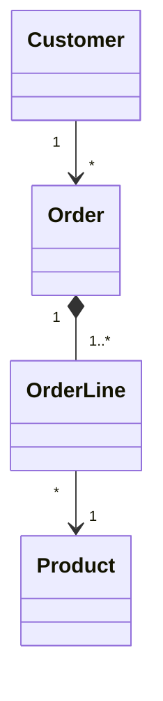
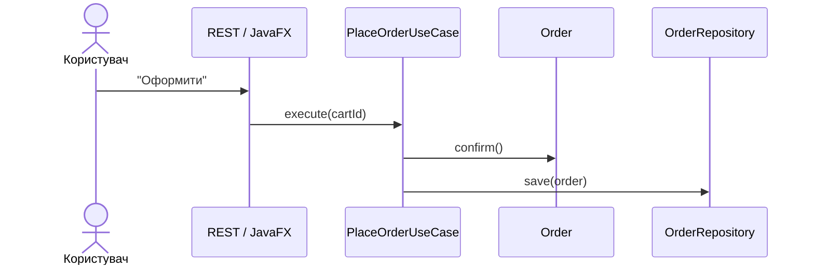
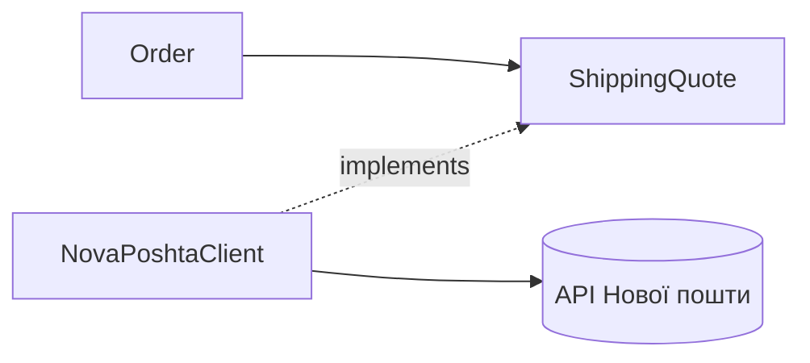

# Методологія GRASP
### Розподіл відповідальностей між об'єктами

---

## План

1. Концепція GRASP і Design Rationale <!-- element class="fragment" -->
2. Information Expert, Creator, Controller <!-- element class="fragment" -->
3. Low Coupling, High Cohesion <!-- element class="fragment" -->
4. Polymorphism, Pure Fabrication, Indirection, Protected Variations <!-- element class="fragment" -->
5. Практика <!-- element class="fragment" -->

---

# Частина 1
## Концепція GRASP

---

## GRASP

**G**eneral **R**esponsibility **A**ssignment **S**oftware **P**atterns — К. Ларман, "Applying UML and Patterns".

Класи відомі: `Order`, `OrderLine`, `Product`. Але:

- хто рахує суму? <!-- element class="fragment" -->
- хто створює рядок замовлення? <!-- element class="fragment" -->
- хто обробляє "Оформити"? <!-- element class="fragment" -->
- хто зберігає в БД? <!-- element class="fragment" -->

<!-- element class="fragment" -->
GRASP — 9 принципів, що відповідають на питання **"хто?"**

---

## Відповідальності

| Знати | Робити |
|---|---|
| свої дані | обчислювати |
| пов'язані об'єкти | створювати об'єкти |
| похідні значення | координувати інших |

| Патерн | Питання |
|---|---|
| Information Expert | хто має знати / обчислювати? |
| Creator | хто створює? |
| Controller | хто обробляє системну подію? |
| Low Coupling / High Cohesion | як оцінити рішення? |
| Polymorphism | як обробити варіанти за типом? |
| Pure Fabrication | куди покласти те, чого немає в домені? |
| Indirection | як розв'язати два елементи? |
| Protected Variations | як захиститись від змін? |

---

## Предметна область



```java
public record Product(String sku, String title, BigDecimal price) {}
public record Customer(long id, String name, String email) {}
```

---

## Design Rationale

Записане обґрунтування: **чому** рішення саме таке.

| Розділ       | Зміст                            |
| ------------ | -------------------------------- |
| Проблема     | яку відповідальність призначаємо |
| Альтернативи | класи-кандидати                  |
| Рішення      | обраний клас                     |
| Аргумент     | GRASP-патерн / принцип           |
| Наслідки     | плюси і мінуси                   |

<!-- element class="fragment" -->
У командах — **ADR** (Architecture Decision Record): markdown-файл у `docs/adr/`.

---

## Приклад

```text
ПРОБЛЕМА:     Хто обчислює суму замовлення?
АЛЬТЕРНАТИВИ: OrderService, Order, CheckoutController
РІШЕННЯ:      Order.total(), що делегує OrderLine.subtotal()
АРГУМЕНТ:     Information Expert — Order знає рядки, OrderLine — кількість і ціну.
              Low Coupling — OrderService не залежить від OrderLine.
НАСЛІДКИ:     + формула рядка змінюється лише в OrderLine
              − Order залежить від Product через OrderLine
```

---

# Частина 2
## Базові патерни

---

## Information Expert

Відповідальність — класу, що має **потрібну інформацію**.

```java
// Погано: сервіс розбирає чужі об'єкти
BigDecimal sum = BigDecimal.ZERO;
for (OrderLine line : order.getLines())
    sum = sum.add(line.getProduct().getPrice()
            .multiply(BigDecimal.valueOf(line.getQuantity())));
```

```java
// Добре: кожен рахує своє
public record OrderLine(Product product, int quantity) {
    public BigDecimal subtotal() {
        return product.price().multiply(BigDecimal.valueOf(quantity));
    }
}

public class Order {
    private final List<OrderLine> lines = new ArrayList<>();
    public BigDecimal total() {
        return lines.stream().map(OrderLine::subtotal).reduce(BigDecimal.ZERO, BigDecimal::add);
    }
}
```
<!-- element class="fragment" -->

---

## Межі Expert

Хто зберігає `Order` в БД? Дані має `Order`…

```java
public class Order {
    public void save(Connection conn) { ... }
}
```

- `Order` залежить від JDBC <!-- element class="fragment" -->
- бізнес-логіка змішана з інфраструктурою <!-- element class="fragment" -->

<!-- element class="fragment" -->
Expert — перший кандидат. Якщо він псує зачеплення чи згуртованість → **Pure Fabrication**.

---

## Creator

B створює A, якщо B:

1. містить / агрегує A <!-- element class="fragment" -->
2. реєструє A <!-- element class="fragment" -->
3. тісно використовує A <!-- element class="fragment" -->
4. має дані для ініціалізації A <!-- element class="fragment" -->

```java
public class Order {
    private final List<OrderLine> lines = new ArrayList<>();

    public void addLine(Product product, int quantity) {
        if (status != Status.DRAFT) throw new IllegalStateException("замовлення закрите");
        lines.add(new OrderLine(product, quantity));
    }

    public List<OrderLine> lines() { return List.copyOf(lines); }
}
```
<!-- element class="fragment" -->

<!-- element class="fragment" -->
Складне створення → окремий клас (Pure Fabrication). Сервіси створює DI-контейнер.

---

## Controller

Перший об'єкт **поза UI**, що отримує системну подію і координує її.



---

## Use-case контролер

```java
public class PlaceOrderUseCase {
    private final OrderRepository orders;
    private final Notifier notifier;

    public OrderId execute(long cartId) {
        Order order = orders.findById(cartId).orElseThrow();
        order.confirm();                 // правила — в Order
        orders.save(order);
        notifier.notify(order.customerEmail(), "Замовлення #" + order.id());
        return order.id();
    }
}

@RestController
class OrderHttpEndpoint {
    private final PlaceOrderUseCase placeOrder;

    @PostMapping("/carts/{id}/checkout")
    OrderDto checkout(@PathVariable long id) { return OrderDto.from(placeOrder.execute(id)); }
}
```

- `@RestController` — частина UI (HTTP) <!-- element class="fragment" -->
- GRASP Controller — `PlaceOrderUseCase` <!-- element class="fragment" -->
- **Bloated controller**: один клас на всі події з власною бізнес-логікою <!-- element class="fragment" -->

---

# Частина 3
## Coupling і Cohesion

---

## Дві оцінні метрики

| | Зачеплення | Згуртованість |
|---|---|---|
| Міряє | залежність від інших | зв'язок елементів усередині |
| Хочемо | низьке | високу |

X зачеплений з Y, якщо має поле типу Y, викликає Y, приймає/повертає Y, успадковує Y.

```java
// A: контролер зачеплений з Order і Payment
order.pay(new Payment(amount));

// B: контролер зачеплений лише з Order
order.pay(amount);
```
<!-- element class="fragment" -->

---

## Види зачеплення

| Від слабкого до сильного | Приклад |
|---|---|
| даних | `total(int qty, BigDecimal price)` |
| структур | передаємо об'єкт заради одного поля |
| керування | `print(doc, true, false)` |
| спільне | глобальний `static` стан |
| вмісту | `setAccessible(true)` на чужому полі |

---

## Метрики зачеплення

- **Ca** — скільки модулів залежать від цього
- **Ce** — від скількох залежить цей
- **I** = Ce / (Ca + Ce): 0 — стабільний, 1 — нестабільний

| Пакет | Ca | Ce | I |
|---|---|---|---|
| `domain` | 5 | 0 | 0.0 |
| `persistence` | 1 | 3 | 0.75 |
| `web` | 0 | 4 | 1.0 |

<!-- element class="fragment" -->
Залежності спрямовані до стабільних модулів: `web → domain`.

---

## Рівні згуртованості

| Від гіршого до кращого | Разом, бо… |
|---|---|
| випадкова | так склалось (`Utils`) |
| логічна | схожа категорія |
| часова | виконуються в один час (`init()`) |
| процедурна | ідуть одне за одним |
| комунікаційна | працюють з одними даними |
| послідовна | вихід одного — вхід іншого |
| функціональна | одна чітка задача ✅ |

---

## LCOM

Групуємо методи за спільними полями:

```java
class Student {
    private String name;
    private List<Integer> grades;
    private String smtpHost;

    String greeting() { /* name */ }
    double average()  { /* grades */ }
    boolean passed()  { /* grades */ }
    void sendEmail()  { /* smtpHost */ }
}
```

<!-- element class="fragment" -->
Групи: `{greeting}`, `{average, passed}`, `{sendEmail}` → **LCOM4 = 3**, клас варто розділити.

---

# Частина 4
## Просунуті патерни

---

## Polymorphism

Поведінка залежить від типу → поліморфні операції замість `if`/`switch`.

```java
public interface TaxCategory { BigDecimal tax(BigDecimal price); }

public enum StandardTax implements TaxCategory {
    FOOD     { public BigDecimal tax(BigDecimal p) { return p.multiply(new BigDecimal("0.07")); } },
    MEDICINE { public BigDecimal tax(BigDecimal p) { return BigDecimal.ZERO; } },
    GENERAL  { public BigDecimal tax(BigDecimal p) { return p.multiply(new BigDecimal("0.20")); } }
}

public record Product(String sku, BigDecimal price, TaxCategory taxCategory) {
    public BigDecimal tax() { return taxCategory.tax(price); }
}
```

| | Поліморфізм | `sealed` + switch |
|---|---|---|
| Набір типів | відкритий | закритий |
| Новий тип | новий клас | компілятор покаже всі `switch` |
| Нова операція | зміна всіх класів | нова функція |

---

## Pure Fabrication

Штучний клас поза доменом — заради High Cohesion і Low Coupling.

```java
public interface OrderRepository {
    Optional<Order> findById(long id);
    void save(Order order);
}
```

| Клас | Навіщо |
|---|---|
| `OrderRepository` | збереження |
| `PasswordHasher` | алгоритм хешування |
| `InvoicePdfRenderer` | формат документа |
| `PlaceOrderUseCase` | координація |
| `Clock`, `IdGenerator` | детерміновані тести |

<!-- element class="fragment" -->
Ризик — **анемічна модель**: уся поведінка в сервісах, `Order` — лише геттери.

---

## Indirection

Посередник між двома компонентами, щоб розв'язати пряму залежність.

```java
public interface ShippingQuote {
    BigDecimal cost(Address to, Weight weight);
}

public class NovaPoshtaClient implements ShippingQuote {
    private final HttpClient http;

    public BigDecimal cost(Address to, Weight w) {
        var json = http.send(buildRequest(to, w), BodyHandlers.ofString()).body();
        return extractCost(json);
    }
}
```



Приклади: брокер повідомлень, JDBC `DriverManager`, JVM між байткодом і ОС.

---

## Protected Variations

Точки ймовірних змін обгортаються **стабільним інтерфейсом**.

```java
public interface ExchangeRates {
    BigDecimal rate(Currency from, Currency to, LocalDate date);
}

public class NbuExchangeRates implements ExchangeRates { ... }
public class CachedExchangeRates implements ExchangeRates {
    private final ExchangeRates origin;
    private final Map<Key, BigDecimal> cache = new ConcurrentHashMap<>();

    public BigDecimal rate(Currency from, Currency to, LocalDate date) {
        return cache.computeIfAbsent(new Key(from, to, date), k -> origin.rate(from, to, date));
    }
}
```

Механізми: інкапсуляція, інтерфейси, поліморфізм, Indirection, OCP, DIP, закон Деметри.

<!-- element class="fragment" -->
Захищаємо **точки варіації** (вже існують), а не гіпотетичні зміни.

---

## Закон Деметри

```java
String city = order.getCustomer().getAddress().getCity();   // знаємо будову 3 об'єктів
String city = order.deliveryCity();                          // питаємо найближчого
```

Метод викликає методи лише: `this`, параметрів, створених ним об'єктів, своїх полів.

<!-- element class="fragment" -->
Не стосується `stream().filter().map()` і навігації по record-DTO.

---

## GRASP ↔ SOLID

| GRASP | SOLID |
|---|---|
| Controller | SRP |
| High Cohesion | SRP, ISP |
| Low Coupling | DIP, ISP |
| Polymorphism | OCP, LSP |
| Pure Fabrication | SRP |
| Indirection | DIP |
| Protected Variations | OCP, DIP |

---

## Підсумок

- **Expert** — у кого дані; **Creator** — хто містить; **Controller** — хто координує подію <!-- element class="fragment" -->
- **Low Coupling + High Cohesion** — критерії оцінки рішення <!-- element class="fragment" -->
- **Polymorphism** замість `switch` за типом <!-- element class="fragment" -->
- **Pure Fabrication** — коли Expert псує згуртованість <!-- element class="fragment" -->
- **Indirection**, **Protected Variations** — стабільні інтерфейси навколо нестабільного <!-- element class="fragment" -->
- Рішення фіксуємо в **Design Rationale** <!-- element class="fragment" -->

---

# Практика

---

## Задача 1. Expert

Бібліотека: `Member`, `Book`, `Loan(book, member, dueDate, returnedAt)`.

Кому призначити:
1. `isOverdue(today)`
2. `fine(today)` — 5 грн за день прострочки
3. `canBorrow(today)` — до 3 активних видач і без прострочених

--

## Задача 1. Розв'язок

```java
public record Loan(Book book, Member member, LocalDate dueDate, LocalDate returnedAt) {
    public boolean isActive() { return returnedAt == null; }

    public boolean isOverdue(LocalDate today) {
        return isActive() && today.isAfter(dueDate);
    }

    public BigDecimal fine(LocalDate today) {
        if (!isOverdue(today)) return BigDecimal.ZERO;
        return BigDecimal.valueOf(5 * ChronoUnit.DAYS.between(dueDate, today));
    }
}

public class Member {
    private final List<Loan> loans = new ArrayList<>();

    public boolean canBorrow(LocalDate today) {
        var active = loans.stream().filter(Loan::isActive).toList();
        return active.size() < 3 && active.stream().noneMatch(l -> l.isOverdue(today));
    }
}
```

---

## Задача 2. Creator і Controller

Кінотеатр: `Session`, `Seat`, `Booking`, `Customer`. Подія — "Забронювати місця".

1. Хто створює `Booking`?
2. Хто — GRASP Controller?

--

## Задача 2. Розв'язок

```java
public class Session {                                  // Creator
    private final Set<Seat> taken = new HashSet<>();

    public Booking book(Customer c, Set<Seat> seats) {
        if (!Collections.disjoint(taken, seats))
            throw new IllegalStateException("місця зайняті");
        taken.addAll(seats);
        return new Booking(this, c, seats);
    }
}

public class BookSeatsUseCase {                         // Controller
    private final SessionRepository sessions;
    private final CustomerRepository customers;
    private final BookingRepository bookings;

    public BookingId execute(long sessionId, long customerId, Set<Seat> seats) {
        Session s = sessions.findById(sessionId).orElseThrow();
        Booking b = s.book(customers.findById(customerId).orElseThrow(), seats);
        sessions.save(s);
        bookings.save(b);
        return b.id();
    }
}
```

---

## Задача 3. Cohesion

```java
public class ReportManager {
    private DataSource db;
    private String smtpHost;
    private DateTimeFormatter formatter;

    public List<Sale> loadSales(LocalDate from) { /* db */ }
    public BigDecimal totalRevenue(List<Sale> s) { /* — */ }
    public String formatDate(LocalDate d) { /* formatter */ }
    public void emailReport(String to, String body) { /* smtpHost */ }
}
```

Визначте LCOM4 і розбийте клас, назвавши GRASP-патерни.

--

## Задача 3. Розв'язок

LCOM4 = 4: кожен метод працює з окремими даними.

```java
interface SalesRepository { List<Sale> since(LocalDate from); }          // Pure Fabrication
record SalesReport(List<Sale> sales) { BigDecimal totalRevenue() { ... } } // Expert
class ReportFormatter { String formatDate(LocalDate d) { ... } }          // Pure Fabrication
interface ReportSender { void send(String to, String body); }             // Indirection
class SendDailyReportUseCase { ... }                                       // Controller
```

---

## Задача 4. Нестабільність

```text
web         → application, domain
application → domain, persistence
persistence → domain
domain      → —
```

Порахуйте I для кожного пакета. Яка залежність порушує DIP?

--

## Задача 4. Розв'язок

| Пакет | Ca | Ce | I |
|---|---|---|---|
| `web` | 0 | 2 | 1.00 |
| `application` | 1 | 2 | 0.67 |
| `persistence` | 1 | 1 | 0.50 |
| `domain` | 3 | 0 | 0.00 |

`application → persistence` порушує DIP. Інтерфейси репозиторіїв переносимо в `application`, `persistence` їх реалізує:

```text
persistence → application, domain
```

---

# Питання?
